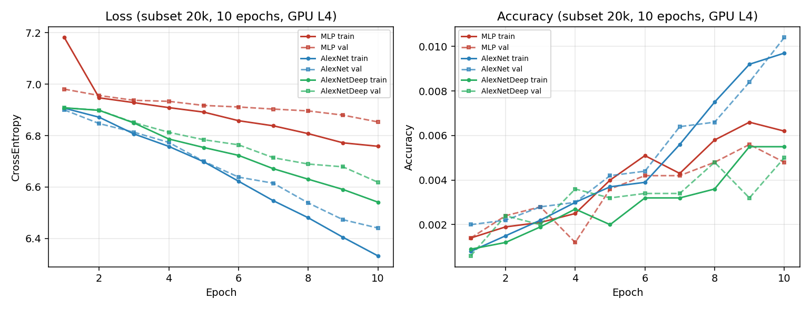
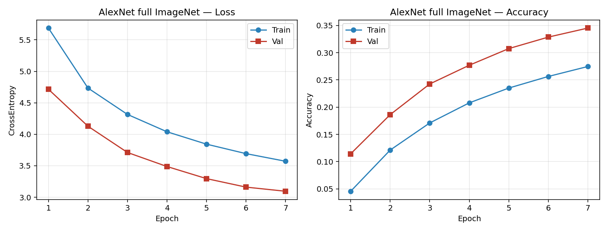

# TP 3 — Réseaux convolutifs

**CSC 8607** — Nassim EL HADDAD

---

## 1. Préparation d'ImageNet

Les pipelines de prétraitement utilisées sont les suivantes :

- Train : `RandomResizedCrop(227)` → `RandomHorizontalFlip` → `ToTensor` → `Normalize`
- Val : `Resize(256)` → `CenterCrop(227)` → `ToTensor` → `Normalize`

**Pourquoi utiliser `Normalize` ?**

Après `ToTensor`, les valeurs des pixels sont comprises entre 0 et 1. La normalisation permet de recentrer et de remettre ces valeurs à une échelle adaptée à l'apprentissage du réseau. Elle facilite ainsi la convergence et rend l'entraînement plus stable.

Les valeurs de moyenne et d'écart-type doivent être calculées uniquement à partir du jeu d'entraînement. Utiliser également les données de validation pour les déterminer reviendrait à introduire une forme de fuite d'information.

**Pourquoi utiliser des augmentations uniquement sur le jeu d'entraînement ?**

Les augmentations comme le crop aléatoire et le retournement horizontal permettent de présenter au réseau des variantes des mêmes images. Cela augmente artificiellement la diversité des données d'entraînement et limite le risque de surapprentissage.

En validation, l'objectif est au contraire d'obtenir une mesure reproductible des performances. On utilise donc un prétraitement déterministe, avec un redimensionnement suivi d'un crop centré, sans augmentation aléatoire.

**Dans quels cas le retournement horizontal peut-il être problématique ?**

Le retournement horizontal n'est pas toujours pertinent. Il peut modifier le sens ou la signification de l'image lorsque la position gauche/droite constitue une information importante pour la classification. C'est notamment le cas pour certains chiffres ou caractères, comme 6 et 9 ou b et d, mais également pour des panneaux de signalisation ou des situations où la distinction entre une main gauche et une main droite est importante.

---

## 2. MLP vs AlexNet

L'image d'entrée contient $3\times227\times227 = 154\,587$ valeurs. Dans un MLP, l'image doit être aplatie avant d'être envoyée aux couches entièrement connectées.

| Couche | Formule (avec biais) | Paramètres |
|--------|----------------------|------------|
| Linear1 | $154587\times256+256$ | 39 574 528 |
| Linear2 | $256\times256+256$ | 65 792 |
| Linear3 | $256\times1000+1000$ | 257 000 |
| **Total** | | **39 897 320** |

La première couche concentre donc l'immense majorité des paramètres du réseau. À elle seule, elle contient environ 39,6 millions de paramètres, soit près de 99 % des paramètres du MLP.

Le principal défaut du MLP n'est cependant pas uniquement le nombre de paramètres. En aplatissant l'image, on perd complètement sa structure spatiale : deux pixels voisins dans l'image ne sont plus traités comme des éléments voisins par le réseau. Le MLP ne bénéficie donc ni du partage de poids, ni du biais inductif apporté par les convolutions, ce qui le rend particulièrement peu adapté au traitement d'images.

AlexNet conserve au contraire la structure spatiale des images grâce aux couches convolutives. Les mêmes filtres sont appliqués à différentes positions de l'image, ce qui permet notamment de détecter des motifs indépendamment de leur position exacte. Cela explique pourquoi une architecture convolutionnelle peut être beaucoup plus adaptée à la classification d'images, même avec un nombre de paramètres du même ordre de grandeur.

| Couche | Entrée | Hyperparamètres | Sortie | Param. | KB |
|--------|--------|-----------------|--------|--------|-----|
| Conv1 + ReLU | 3, 227×227 | 64, 11×11, S4, P2 | 64, 56×56 | 23 296 | 784 |
| MaxPool1 | 64, 56×56 | 3×3, S2 | 64, 27×27 | 0 | 182 |
| Conv2 + ReLU | 64, 27×27 | 192, 5×5, S1, P2 | 192, 27×27 | 307 392 | 547 |
| MaxPool2 | 192, 27×27 | 3×3, S2 | 192, 13×13 | 0 | 127 |
| Conv3 + ReLU | 192, 13×13 | 384, 3×3, S1, P1 | 384, 13×13 | 663 936 | 254 |
| Conv4 + ReLU | 384, 13×13 | 256, 3×3, S1, P1 | 256, 13×13 | 884 992 | 169 |
| Conv5 + ReLU | 256, 13×13 | 256, 3×3, S1, P1 | 256, 13×13 | 590 080 | 169 |
| MaxPool3 | 256, 13×13 | 3×3, S2 | 256, 6×6 | 0 | 36 |
| Flatten + Drop. | 256, 6×6 | p=0,5 | 9216 | 0 | 36 |
| Linear1 + Drop. | 9216 | 4096, p=0,5 | 4096 | 37 752 832 | 16 |
| Linear2 + ReLU | 4096 | 4096 | 4096 | 16 781 312 | 16 |
| Linear3 | 4096 | 1000 | 1000 | 4 097 000 | 4 |

Total AlexNet : **61 100 840** paramètres (~2340 KB d'activations).

Pour AlexNet, la majorité des paramètres se trouve également dans les couches entièrement connectées finales. En revanche, les premières couches produisent des cartes de caractéristiques relativement grandes, ce qui explique qu'elles représentent une part importante de la mémoire utilisée pour stocker les activations pendant la rétropropagation.

---

## 3. Entraînement et comparaison (subset 20k)

Lors de l'entraînement, `train()` active notamment le comportement du Dropout. À l'inverse, `eval()` désactive le Dropout et place les autres couches concernées dans leur mode d'évaluation.

Il est donc important d'utiliser `eval()` pendant la validation. Dans le cas contraire, le Dropout continuerait à supprimer aléatoirement certaines activations, ce qui rendrait les mesures de validation moins stables et moins représentatives des performances réelles du modèle.

Avec 1000 classes et une initialisation aléatoire, on s'attend initialement à une accuracy proche de $1/1000$, soit environ $0{,}001$. De même, la cross-entropy attendue pour une prédiction uniforme est proche de $\ln(1000)\approx6{,}9$.

| Modèle | Train Loss | Val Loss | Train Acc | Val Acc |
|--------|------------|----------|-----------|---------|
| MLP | 6,76 | 6,85 | 0,006 | 0,005 |
| AlexNet | 6,33 | 6,44 | 0,010 | 0,010 |
| AlexNetDeep | 6,54 | 6,62 | 0,006 | 0,005 |

Les résultats obtenus après 10 époques montrent qu'AlexNet est le modèle qui apprend le mieux sur le subset de 20 000 images. Sa loss de validation et son accuracy sont légèrement meilleures que celles du MLP et d'AlexNetDeep.

Le MLP reste très proche d'un comportement aléatoire. Son architecture entièrement connectée exploite mal la structure spatiale des images et doit apprendre directement un très grand nombre de relations entre les pixels.

AlexNet obtient de meilleurs résultats grâce aux convolutions, qui permettent d'extraire progressivement des caractéristiques visuelles pertinentes. AlexNetDeep obtient quant à lui des performances inférieures à celles d'AlexNet sur cette expérience. À ce stade de l'entraînement, cela semble davantage correspondre à un problème d'apprentissage insuffisant qu'à de l'overfitting : le modèle plus profond n'a pas encore réussi à exploiter pleinement sa capacité.

---

## 4. ImageNet complet (sbatch)

Le modèle AlexNet a ensuite été entraîné sur l'ensemble d'ImageNet avec un GPU L4. Une époque dure environ **25 minutes**, ce qui représente environ **42 heures** pour 100 époques.

| Ép. | Train Loss | Train Acc | Val Loss | Val Acc |
|-----|------------|-----------|----------|---------|
| 1 | 5,69 | 0,046 | 4,72 | 0,114 |
| 2 | 4,73 | 0,121 | 4,13 | 0,186 |
| 3 | 4,32 | 0,171 | 3,71 | 0,243 |
| 4 | 4,04 | 0,208 | 3,49 | 0,277 |
| 5 | 3,84 | 0,235 | 3,30 | 0,308 |
| 6 | 3,69 | 0,256 | 3,16 | 0,329 |
| 7 | 3,57 | 0,275 | 3,09 | 0,345 |
| 8 | 3,47 | 0,289 | 2,98 | 0,365 |

Les performances progressent rapidement au cours des premières époques. À l'époque 8, l'accuracy de validation atteint environ 36,5 %, contre seulement 0,1 % attendus pour des prédictions aléatoires sur 1000 classes. Le réseau a donc clairement appris des représentations pertinentes pour la classification des images.

Les performances obtenues sur ImageNet complet sont également nettement meilleures que celles observées sur le subset de 20 000 images. L'utilisation d'un jeu de données beaucoup plus important fournit davantage d'exemples au modèle et lui permet de mieux généraliser. Les augmentations de données utilisées pendant l'entraînement contribuent également à limiter la mémorisation des exemples d'entraînement.

À l'époque 8, l'écart entre les performances d'entraînement et de validation reste raisonnable. On n'observe donc pas, à ce stade, de signe particulièrement marqué de surapprentissage.

On peut également observer qu'au début de l'entraînement, la loss de validation peut être légèrement inférieure à celle du train. Cela n'est pas nécessairement anormal. Pendant l'entraînement, le Dropout est actif et les images sont soumises à des augmentations aléatoires, ce qui rend la tâche plus difficile pour le modèle. En validation, le Dropout est désactivé et les images suivent un prétraitement déterministe. Le modèle peut donc obtenir temporairement de meilleures performances sur la validation que sur les données d'entraînement.
