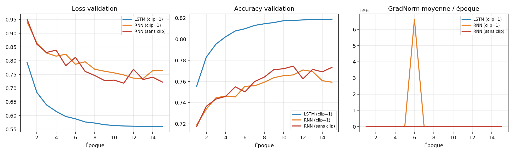
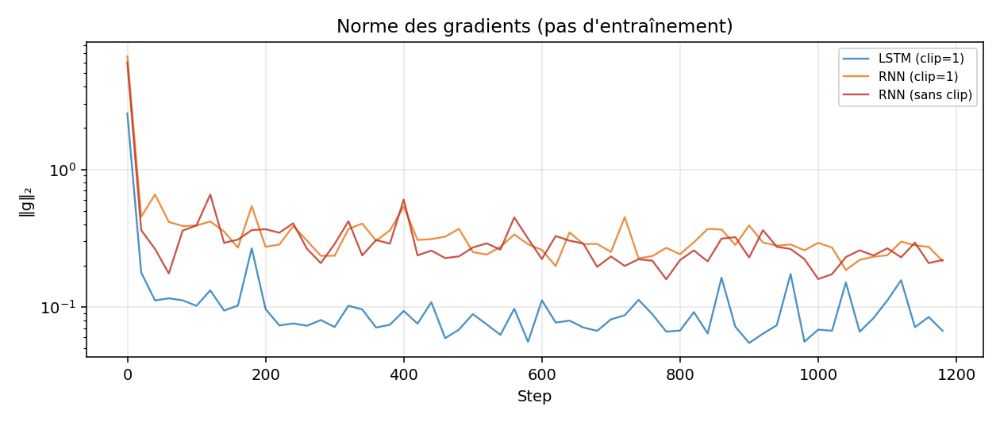
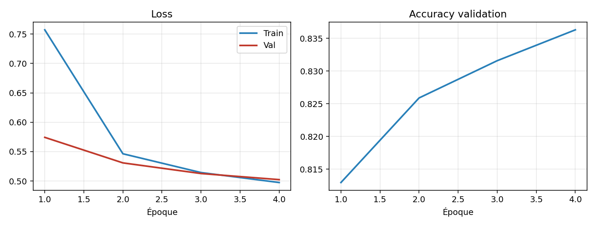

# TP 4 - Réseaux récurrents

**CSC 8607** - Nassim EL HADDAD

## 1. Exploration et prétraitement

Le corpus utilisé est constitué de partitions musicales au format ABC. Il contient **214 122 partitions d'entraînement** et **2 162 partitions de validation**. Le vocabulaire, construit au niveau caractère, comporte **95 symboles différents**. Les partitions d'entraînement ont une longueur moyenne de **290,1 caractères**, avec un maximum de **2 968 caractères**.

Les premières lignes d'une partition correspondent à ses métadonnées. Par exemple, `X:` permet d'identifier la partition, `L:` définit la durée de référence des notes, `M:` indique la métrique et `K:` la tonalité. Les notes et les barres de mesure apparaissent ensuite dans le contenu musical.

**Pourquoi trier le vocabulaire ?**

Le vocabulaire est construit à partir d'un ensemble de caractères. Or, un `set` Python ne garantit pas un ordre identique entre deux exécutions. Sans tri explicite avec `sorted(...)`, l'association entre chaque caractère et son indice pourrait donc changer.

Cette association est utilisée pendant l'entraînement pour convertir les caractères en indices, mais elle doit également rester identique lors du chargement du modèle et de la génération. Sinon, un même indice pourrait correspondre à un caractère différent et rendre les prédictions incohérentes.

**Pourquoi tronquer les partitions à 500 caractères ?**

La longueur moyenne des partitions est d'environ 290 caractères. Une longueur maximale de 500 permet donc de conserver une grande partie de l'information utile tout en évitant de travailler systématiquement avec la longueur maximale de 2 968 caractères.

Utiliser directement cette longueur maximale augmenterait fort le coût de la BPTT et la mémoire GPU. Les partitions courtes devraient aussi être remplies de beaucoup de padding, ce qui pèserait trop dans le calcul de la loss.

## 2. Dataset auto-régressif et modèles

Avec `SEQ_LENGTH=500`, chaque partition est soit tronquée, soit complétée par du padding afin d'obtenir une longueur fixe de 500 caractères. Le principe du dataset auto-régressif consiste ensuite à décaler la séquence d'un caractère : `x` contient les 499 premiers caractères et `y` les 499 caractères suivants.

Avec un batch de 128 partitions, les tenseurs transmis au modèle ont donc une forme $(128,499)$. Les données sont stockées en `torch.long`, car elles représentent des indices de caractères. Ce type est requis par `nn.Embedding` et `CrossEntropyLoss`.

**Nombre de paramètres**

Pour $V=95$, $E=256$ et $H=512$, l'embedding contient $V\times E=24\,320$ paramètres. Le bloc RNN contient $394\,240$ paramètres et la couche linéaire finale $48\,735$ paramètres, soit un total de **467 295 paramètres** pour le modèle RNN.

Pour le LSTM, le bloc récurrent contient quatre fois plus de paramètres, soit $1\,576\,960$. Le LSTM utilise quatre portes, chacune avec ses matrices et ses biais. Au total, le modèle LSTM compte **1 650 015 paramètres**.

| Architecture | Embedding | Bloc récurrent | FC / Total |
|--------------|-----------|----------------|------------|
| RNN | 24 320 | 394 240 | 48 735 / **467 295** |
| LSTM | 24 320 | 1 576 960 | 48 735 / **1 650 015** |

Une couche `nn.Embedding` convient bien ici. Les indices des caractères sont des catégories, sans relation numérique entre eux. Les passer tels quels à une couche linéaire donnerait une fausse idée de distance entre symboles. L'embedding associe chaque symbole à un vecteur appris de façon indépendante.

Une autre différence importante entre les deux architectures concerne leur état interne. Le RNN renvoie un état caché $h_t$, tandis que le LSTM conserve deux états, $(h_t,c_t)$. Le *cell state* $c_t$ constitue une mémoire à plus long terme, contrôlée par les différentes portes du LSTM.

## 3. Entraînement et comparaison RNN / LSTM

Avant de calculer la `CrossEntropyLoss`, les dimensions des tenseurs doivent être adaptées. Les logits passent de $(B,T,V)$ à $(B\times T,V)$ et les cibles de $(B,T)$ à $(B\times T)$. Avec $B=128$ et $T=499$, cela représente donc $128\times499=63\,872$ prédictions de caractères.

Le clipping des gradients se fait après `backward()` et avant `optimizer.step()` : les gradients n'existent qu'après la rétropropagation, et il faut borner leur norme avant la mise à jour.

Les résultats obtenus sur le subset de 10 000 partitions montrent une nette différence entre les modèles. Le LSTM obtient les meilleures performances, avec une **Val Loss de 0,56** et une **accuracy de 81,9 %**, contre 77,3 % pour le RNN sans clipping et 75,9 % pour le RNN avec clipping.

| Modèle | Val Loss | Val Acc | GradNorm moy. |
|--------|----------|---------|---------------|
| RNN sans clip | 0,72 | 77,3 % | 0,22 |
| RNN clip=1 | 0,76 | 75,9 % | 0,27 |
| **LSTM clip=1** | **0,56** | **81,9 %** | 0,08 |

Le clipping est surtout utile pour le RNN. Autour de la sixième époque, la norme des gradients grimpe à plusieurs millions. C'est une **explosion des gradients**, classique quand on rétropropage sur de longues séquences.

La fonction `clip_grad_norm_` mesure d'abord la norme, puis la borne à la valeur choisie. Ça évite des mises à jour instables. En revanche, le clipping ne règle pas le problème inverse : la disparition des gradients.

Le LSTM s'en sort mieux grâce à sa mémoire. Son *cell state* suit la relation

$$c_t = f_t \odot c_{t-1} + i_t \odot \tilde{c}_t$$

Cette mise à jour additive laisse le gradient circuler plus facilement sur de longues séquences. Quand la *forget gate* reste proche de 1, des informations peuvent être gardées sur beaucoup de pas. En musique, ça aide à retenir le rythme ou des motifs apparus plus tôt dans la partition.

L'accuracy reste à prendre avec précaution. Les partitions courtes sont remplies jusqu'à 500 caractères : beaucoup de padding, facile à prédire, ce qui gonfle un peu la métrique. On pourrait utiliser `CrossEntropyLoss(ignore_index=...)` pour ignorer ce padding dans la loss.

## 4. Génération et entraînement long

### Complexité et température

Lors de la génération, le modèle peut réutiliser son état caché et ne traiter qu'un seul nouveau caractère à chaque étape. Pour générer $N$ caractères, chaque étape étant effectuée une seule fois, la complexité est alors en $O(N)$.

Sans réutiliser l'état caché, il faudrait à chaque étape repasser l'ensemble de la séquence déjà générée dans le modèle. Le nombre de calculs augmenterait alors avec la longueur de la séquence, ce qui conduirait à une complexité en $O(N^2)$.

La température $T$ permet de contrôler le niveau d'aléatoire lors du choix du prochain caractère. Avec une température très faible, comme $T=0.2$, la distribution se concentre fortement sur les caractères les plus probables. La génération devient alors plus prévisible, mais également plus répétitive.

À l'inverse, une température élevée augmente la diversité des sorties. Lorsque $T$ devient très grande, la distribution se rapproche d'une distribution uniforme et les caractères moins probables sont davantage sélectionnés. La génération devient alors plus imprévisible et peut perdre en cohérence.

### Exemples générés

Les exemples générés avec l'amorce *Irish Reel* montrent bien l'effet de la température. À $T=0.2$, la syntaxe ABC reste globalement correcte, mais la sortie est très répétitive : le modèle choisit presque toujours les caractères les plus probables.

Avec $T=0.8$, le résultat constitue un meilleur compromis entre diversité et cohérence. Les rythmes et les enchaînements de notes sont plus variés tout en conservant une structure musicale et syntaxique relativement lisible.

Enfin, avec $T=2.0$, la diversité augmente fortement, mais la qualité de la génération se dégrade. On observe davantage de caractères rares, des en-têtes parfois incorrects et des mesures moins régulières. Une température trop élevée favorise donc la diversité au détriment de la validité de la partition.

### Entraînement long avec Slurm

Un entraînement plus important a ensuite été réalisé avec un LSTM de taille cachée $H=1024$, entraîné sur 50 000 partitions pendant jusqu'à 30 époques, avec un clipping des gradients à 1.

Les résultats montrent une amélioration rapide dès les premières époques. À la sixième époque, la validation atteint une accuracy de **83,9 %** avec une Val Loss de **0,50**. Les performances sont déjà supérieures à celles obtenues avec le modèle entraîné sur le subset de 10 000 partitions.

| Ép. | Train Loss | Val Loss | Val Acc |
|-----|------------|----------|---------|
| 1 | 0,76 | 0,57 | 81,3 % |
| 2 | 0,55 | 0,53 | 82,6 % |
| 3 | 0,51 | 0,51 | 83,2 % |
| 4 | 0,50 | 0,50 | 83,6 % |
| 5 | 0,48 | 0,49 | 83,8 % |
| 6 | 0,48 | 0,50 | 83,9 % |

L'utilisation d'un corpus plus important permet donc au modèle de disposer de davantage d'exemples et d'apprendre des représentations plus générales de la structure musicale. Ces résultats confirment l'intérêt d'augmenter la quantité de données disponibles pour ce type de tâche.

### Bonus : transposition

Une piste simple pour augmenter artificiellement la diversité du corpus serait de transposer les mélodies d'un certain nombre de demi-tons. Les notes ABC seraient alors décalées et la tonalité indiquée dans l'en-tête `K:` serait adaptée en conséquence.

On garderait la structure rythmique et mélodique, tout en montrant la même idée musicale dans plusieurs tonalités. Le modèle dépendrait moins des tonalités dominantes du corpus, ce qui limiterait le sur-apprentissage.
